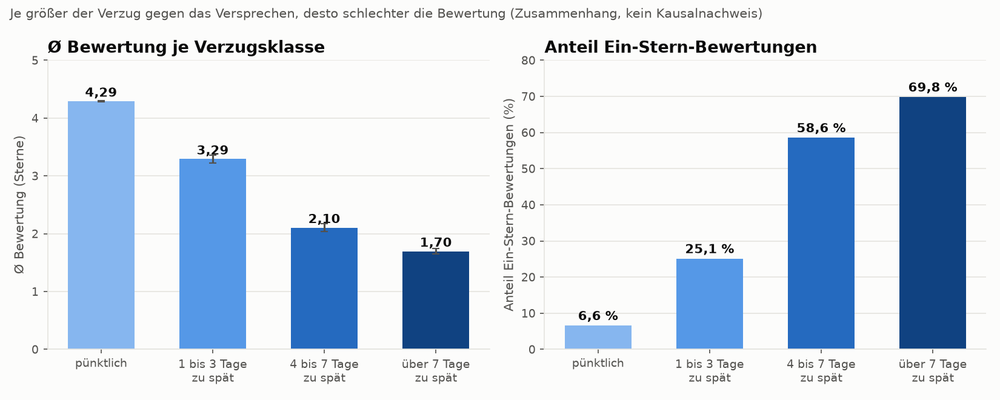
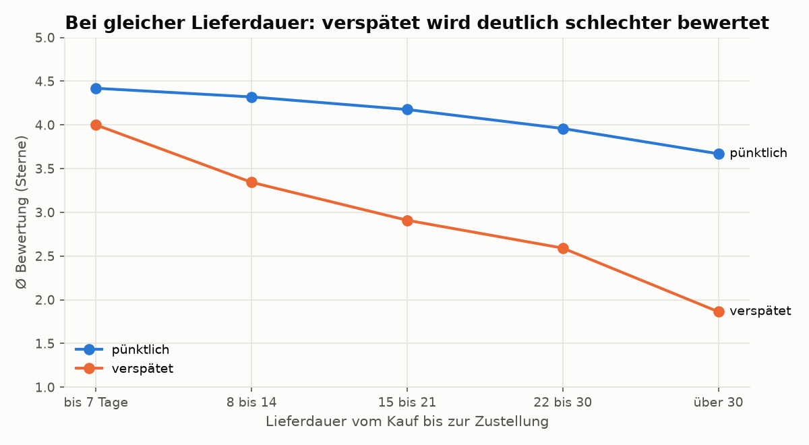
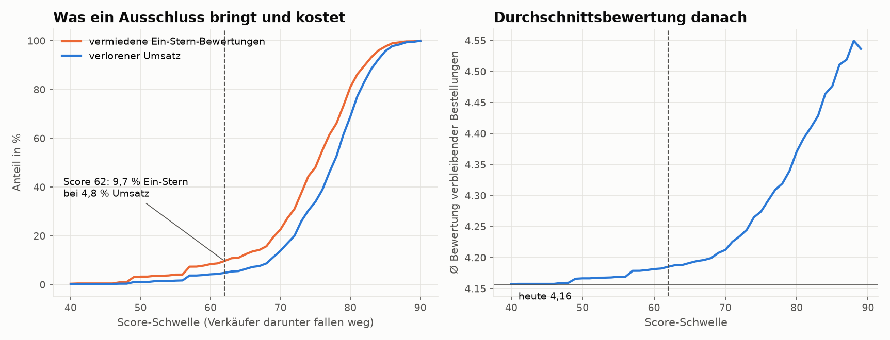

# Commercial & Operations Analytics — Marktplatz-Analyse

**Business-Frage:** Wo verliert ein Online-Marktplatz Kundenzufriedenheit und Marge, und welche Verkäufer sollte er steuern, fördern oder aussortieren?

**Kernergebnis:** Auf die 62 Verkäufer unterhalb Score 62 entfallen 9,7 % aller Ein-Stern-Bewertungen bei nur 4,8 % des Umsatzes. Ein Ausschluss kostet 4,8 % Umsatz und hebt die Durchschnittsbewertung rechnerisch nur um 0,03 Sterne (4,16 auf 4,19). Der größere Hebel ist das Lieferversprechen: Pünktliche Lieferungen erhalten 4,29 Sterne, mehr als eine Woche Verzug 1,70.

**Stack:** DuckDB (SQL, 9 verknüpfte Tabellen) · Python (pandas, numpy, scipy, matplotlib) · Power BI

---

## Daten

Brazilian E-Commerce Public Dataset by Olist (Kaggle: `olistbr/brazilian-ecommerce`), Lizenz **CC BY-NC-SA 4.0** (nicht-kommerziell, Namensnennung, Weitergabe unter gleichen Bedingungen). Verkäufernamen sind im Datensatz pseudonymisiert.

- 99.441 Bestellungen, 112.650 Positionen, 103.886 Zahlungszeilen, 99.224 Bewertungen
- 96.096 reale Kunden (über `customer_unique_id`), 3.095 Verkäufer, 32.951 Produkte
- Zeitraum der Rohdaten: September 2016 bis Oktober 2018
- Analysefenster: Januar 2017 bis August 2018 (Begründung unter Annahmen)
- Währung: Brasilianischer Real (BRL)

### Beziehungsdiagramm

```
customers (customer_id, customer_unique_id)      geolocation (zip_prefix, lat, lng)
      |1                                                 | viele Zeilen je zip_prefix
      |                                                  | -> vor Join auf Median verdichten
      |1                                                 |
   orders (order_id) ---------------------------- sellers (seller_id, zip_prefix)
      |1              |1             |1                  |1
      |n              |n             |0..n               |n
 order_items     order_payments   order_reviews     order_items.seller_id
 (order_id,      (order_id,       (order_id,
  order_item_id)  payment_seq)     review_id)
      |n
      |1
   products (product_id, category_pt) --1--1-- category_translation (category_pt -> en)
```

Die Zahlen an den Kanten sind gemessen, nicht angenommen: Eine Bestellung hat 1 bis 21 Positionen (9.803 Bestellungen mit mehr als einer), 2.961 Bestellungen haben mehrere Zahlungszeilen, 547 haben mehrere Bewertungen, 775 haben gar keine Position (fast alle mit Status `unavailable` oder `canceled`). Belegt in `01_sql/02_validation.sql`, Teil A.

## Methodik

1. Neun Rohtabellen in DuckDB geladen und Schlüsselbeziehungen geprüft (`01_sql/00_load.sql`, `02_validation.sql` Teil A)
2. Star-Schema mit vier Dimensionen (`dim_date`, `dim_customer`, `dim_seller`, `dim_product`) und zwei Faktentabellen (`fact_order_items` auf Positionsebene, `fact_orders` auf Bestellebene, vorverdichtet gegen Fan-out) in `01_sql/01_schema.sql`
3. Datenqualitätsprüfungen inkl. Zahlungsabstimmung und Fan-out-Kontrolle (`01_sql/02_validation.sql`, Teil A und B)
4. Kommerzielle Analysen: Umsatz, Kategorien, Regionen, Zahlverhalten (`01_sql/03_commercial.sql`)
5. Operations: Lieferzeit-Zerlegung, Verzug gegen Versprechen, Bewertungen, Fracht (`01_sql/04_operations.sql`), vertieft mit Gegenprobe, Regression und Robustheitsprüfungen in `02_python/02_delivery_analysis.py`
6. Kunden: RFM-Segmente und Merkmale der Wiederkäufer (`02_python/04_rfm.py`)
7. Verkäufer-Konzentration, Kennzahlen und Kohorten (`01_sql/05_sellers.sql`), Scorecard (`02_python/03_seller_score.py`) und Cutoff-Analyse mit Gegenprobe außerhalb der Stichprobe (`02_python/05_cutoff_analysis.py`)

## Ergebnisse

### Kommerz (`01_sql/03_commercial.sql`)

- **Wachstum.** 13,18 Mio. BRL realisierter Warenumsatz im Analysefenster aus 96.211 zugestellten Bestellungen. Januar bis August 2018 liegt 141,1 % über dem Vorjahreszeitraum, Spitze im November 2017 mit 987.765 BRL.
- **Kategorien.** 18 von 74 Kategorien machen 81,3 % des Umsatzes. Spitzenreiter ist health_beauty mit 9,33 %.
- **Regionen.** Der Sudeste trägt 68,6 % der Bestellungen bei dem niedrigsten Bestellwert (130,61 BRL). Im Norte liegt der Bestellwert bei 181,96 BRL, die Fracht aber bei 22,7 % des Warenwerts statt 15,2 %.
- **Zahlung.** Kreditkarte ist Hauptzahlart bei 75,44 % der Bestellungen. Die Ratenzahl steigt mit dem Bestellwert von 2,08 auf 7,29.

### Operations (`01_sql/04_operations.sql`)

- **Lieferzeit.** Im Schnitt 12,6 Tage: 0,4 Tage Freigabe, 2,8 Tage Bearbeitung beim Verkäufer, 9,4 Tage Transport. Die Bearbeitung ist in allen Regionen gleich, der Transport reicht von 7,6 Tagen im Sudeste bis 19,3 Tagen im Norte.
- **Verzug.** 6,79 % der Zustellungen kommen nach dem versprochenen Datum, im Nordeste 12,76 %. Ausreißer-Monate sind November 2017 und Februar/März 2018 mit bis zu 18,96 %.
- **Verzug und Bewertung.** Je größer der Verzug, desto schlechter die Bewertung:

| Verzug gegen Versprechen | Anteil | Ø Bewertung | Ein-Stern-Anteil |
|---|---|---|---|
| pünktlich | 93,33 % | 4,29 | 6,6 % |
| 1 bis 3 Tage | 1,94 % | 3,29 | 25,1 % |
| 4 bis 7 Tage | 1,83 % | 2,10 | 58,6 % |
| über 7 Tage | 2,91 % | 1,70 | 69,8 % |

Das ist ein Zusammenhang, kein Kausalnachweis (siehe Annahmen und Limitationen).



- **Versprechen schlägt Dauer.** Auch pünktliche Lieferungen werden mit wachsender Dauer etwas schlechter bewertet (4,42 bei bis zu 7 Tagen, 3,67 bei über 30 Tagen). Bei gleicher Dauer geht ein gebrochenes Versprechen aber mit 1,54 Sternen weniger einher, eine Woche längere Lieferung nur mit 0,15 Sternen. Verspätete Bestellungen sind 6,7 % der bewerteten Bestellungen und 36,8 % aller Ein-Stern-Bewertungen.



- **Fracht.** Den höchsten Frachtanteil hat electronics mit 29,5 % des Warenwerts. Über Regionsgrenzen steigt der Frachtanteil von 13,0 % auf 18,8 %, und 83,7 % aller Positionen kommen von Verkäufern aus dem Sudeste.

- **Frachttreiber.** Gewicht erklärt allein 37 % der Streuung des Frachtwerts, Entfernung 15 %, alle drei Faktoren zusammen 56 %. Der Frachtanteil steigt von 11,8 % (bis 100 km) auf 22,7 % (über 2.000 km). Teuerste Route ist SP nach PB mit 43,31 BRL Fracht je Position.

### Kunden (`02_python/04_rfm.py`)

- **Wiederkauf ist selten.** Nur 2,15 % der Kunden kaufen an mehr als einem Tag, innerhalb von 180 Tagen nach dem Erstkauf 1,98 %. Eine klassische Kohortenanalyse wäre daher fast leer.
- **Kategorie und Region unterscheiden Wiederkäufer, Service kaum messbar.** Wer zuerst Taschen und Accessoires, Tierbedarf oder Heimtextilien kauft, kommt bis zu dreimal so oft wieder wie bei cool_stuff (3,3 % gegenüber 1,0 %). Bewertung und Pünktlichkeit der Erstbestellung zeigen in die erwartete Richtung, sind aber statistisch nicht abgesichert.

### Verkäufer (`01_sql/05_sellers.sql`, `02_python/03_seller_score.py`, `02_python/05_cutoff_analysis.py`)

- **Konzentration.** Die Top 10 % der 2.945 Verkäufer mit Umsatz machen 67,0 % des Umsatzes, die untere Hälfte 3,4 %. 60 % der Verkäufer haben weniger als 10 zugestellte Bestellungen.
- **Verkäufer-Kohorten.** Von einer Startkohorte sind nach einem Monat noch 57,6 % aktiv, nach 12 Monaten 35,2 %.
- **Scorecard.** Bewertung 40 %, Verspätungsquote 30 %, Bearbeitungszeit 15 %, Stornoquote 15 %, jede Kennzahl zum Marktmittel gedämpft. Das Ranking ist robust gegenüber anderen Gewichten (Rangkorrelation 0,96 bis 0,98).


- **Cutoff.** Gewählt ist die höchste Schwelle mit höchstens 5 % Umsatzverlust: Score 62.

| Kennzahl | Score 62, ganzes Fenster | Gegenprobe: Score aus 2017, Wirkung 2018 |
|---|---|---|
| Anteil an Ein-Stern-Bewertungen | 9,7 % | 3,3 % |
| Anteil am Umsatz | 4,8 % | 2,2 % |
| Veränderung Ø Bewertung | +0,03 Sterne | +0,01 Sterne |



- **Quadranten.** 27 große, aber schwache Verkäufer tragen 4,4 % des Umsatzes. Sie sind der eigentliche Steuerungsfall. 35 kleine, schwache Verkäufer tragen 0,4 %.


- **Unteres Quartil.** Die 173 Verkäufer im unteren Score-Quartil der verlässlich bewerteten Verkäufer (mindestens 25 Bestellungen) tragen 36,7 % der Ein-Stern-Bewertungen bei 23,3 % des Umsatzes.

## Annahmen und Limitationen

- Kundenbezogene Kennzahlen laufen ausschließlich über `customer_unique_id`. `customer_id` wird pro Bestellung neu vergeben und ist nur der technische Join-Schlüssel zu `orders`. Über `customer_id` gerechnet wäre die Wiederkaufrate exakt null; tatsächlich haben 2.997 Personen mehr als eine Bestellung.
- Zwei Faktentabellen: `fact_orders` ist je `order_id` vorverdichtet (Positionen, Zahlungen, Bewertungen in getrennten CTEs), damit Umsatz und Zahlbetrag nie mehrfach gezählt werden. Kontrollsumme: Warenumsatz 13.591.643,70 BRL, identisch mit der Summe über `order_items`.
- Umsatz ist die Summe der Positionspreise (`price`). Fracht wird getrennt geführt, der Zahlbetrag (`payment_value`) nur für Zahlungsanalysen verwendet.
- Bei 547 Bestellungen mit mehreren Bewertungen zählt die jüngste Bewertung.
- Verzug gegen Lieferversprechen wird in Kalendertagen gerechnet (Zustelldatum minus versprochenes Datum); positiv heißt zu spät.
- Geolocation wird vor dem Join auf den Median je PLZ-Präfix verdichtet, 42 Koordinaten außerhalb Brasiliens werden verworfen.
- **Analysefenster Januar 2017 bis August 2018.** Vor 2017 liegen nur 329 Bestellungen (324 davon im Oktober 2016, im November 2016 keine), nach August 2018 nur 20, weil der Datenabzug dort endet. Beide Ränder würden Zeitreihen verzerren. Das Fenster behält 99.092 Bestellungen (99,65 %).
- **Bestellstatus.** Lieferzeit und Bewertung nur für `delivered` mit gefülltem Zustelldatum (96.203 Bestellungen im Fenster). `canceled` und `unavailable` laufen getrennt als Stornoquote (1,19 % im Fenster).
- **Zahlungsabstimmung.** 254 von 98.665 Bestellungen (0,26 %) weichen beim Zahlbetrag um mehr als 1 % von Warenwert plus Fracht ab, fast alle mit Kreditkarte.
- **Fan-out-Nachweis.** Der naive Join von Bestellungen, Positionen und Zahlungen ergibt 117.601 Zeilen statt 99.441 und überhöht den Zahlbetrag um 26,9 %.
- **Zeitstempel.** Bei 1.359 Bestellungen liegt die Übergabe an die Logistik vor der Zahlungsfreigabe. Für die Lieferzeit-Zerlegung zählen nur Bestellungen mit nicht negativen Teilzeiten.
- **Realisierter Umsatz.** Umsatzanalysen zählen nur zugestellte Bestellungen. Sie tragen 97,34 % des Warenumsatzes im Fenster.
- **Leitgröße Verzug.** Maßgeblich für die Kundenzufriedenheit ist der Verzug gegen das versprochene Datum, nicht die absolute Lieferzeit.
- **Regionen.** Bundesstaat und Region des Kunden kommen aus der Kundendimension (Adresse der jüngsten Bestellung). Das ordnet nur 43 Bestellungen (0,043 %) anders zu als ihre eigene Lieferadresse.
- **Zusammenhang, keine Kausalität.** Verzug und Bewertung hängen stark zusammen, auch innerhalb von Einpositionsbestellungen und jeder Region. Mögliche Störfaktoren sind nachlässige Verkäufer, defekte oder falsch beschriebene Ware und entlegene Lieferadressen. Bestellungen mit mehreren Verkäufern werden schlecht bewertet, obwohl sie fast nie verspätet sind; es gibt also weitere Treiber.
- **Entfernung als Luftlinie** zwischen den Median-Koordinaten der PLZ-Präfixe, nicht als Straßenkilometer.
- **Wiederkauf** zählt nur einen späteren Kauftag innerhalb von 180 Tagen. Mehrere Bestellungen am selben Tag gelten als ein Kauf.
- **Brasilianischer Markt.** Logistik und Zahlungsgewohnheiten (Boleto, Ratenzahlung) sind nicht direkt auf Europa übertragbar.
- **Gewichte der Scorecard sind gesetzt, nicht optimiert** (40/30/15/15). Die Sensitivitätsprüfung zeigt, dass das Ranking kaum an ihnen hängt.
- **Verkäufer mit wenigen Bestellungen haben instabile Kennzahlen.** Sie werden zum Marktmittel gedämpft; die Dämpfungsstärke ist je Kennzahl aus den Daten geschätzt (zum Beispiel 26 Bestellungen bei der Bewertung).
- **Bewertung, Verspätung und Bearbeitung je Verkäufer** zählen nur Bestellungen mit genau einem Verkäufer (98,7 %), weil sich die Bewertung sonst keinem Verkäufer zuordnen lässt.
- **Cutoff über ein Umsatzbudget von 5 %**, weil ohne Margendaten kein Gewinnoptimum berechenbar ist. Der Effekt im ganzen Fenster ist optimistisch, weil der Score dieselben Bewertungen enthält; die Gegenprobe mit einem 2017er Score auf 2018 zeigt einen Effekt von rund einem Drittel.

## Reproduktion

Voraussetzung: Python 3.11 oder neuer. Rohdaten von Kaggle herunterladen und die neun CSV-Dateien nach `data/raw/` legen (nicht im Repo enthalten).

```bash
pip install -r requirements.txt
python 02_python/01_data_prep.py
python 02_python/run_sql.py 01_sql/02_validation.sql
```

`01_data_prep.py` lädt die CSVs (`00_load.sql`), baut das Star-Schema (`01_schema.sql`) und prüft: `fact_orders` = `orders` (99.441 Zeilen), Wiederkaufrate über `customer_unique_id` größer null (3,12 %), Validierung läuft fehlerfrei.

```bash
python 02_python/run_sql.py 01_sql/03_commercial.sql
python 02_python/run_sql.py 01_sql/04_operations.sql
python 02_python/02_delivery_analysis.py
python 02_python/04_rfm.py
python 02_python/run_sql.py 01_sql/05_sellers.sql
python 02_python/03_seller_score.py
python 02_python/05_cutoff_analysis.py
```

Weitere Schritte folgen mit den nächsten Arbeitspaketen.

## Repo-Struktur

```
01_sql/            SQL-Skripte, nummeriert in Ausführungsreihenfolge
02_python/         Python-Skripte, laufen aus dem Repo-Root
03_dashboard/      CSV-Exporte und DAX-Measures für Power BI
data/raw/          Kaggle-CSVs (nicht im Repo)
data/olist.duckdb  DuckDB-Datei (wird erzeugt, nicht im Repo)
reports/           findings.md, interview_notes.md, walkthrough.md, figures/
```
