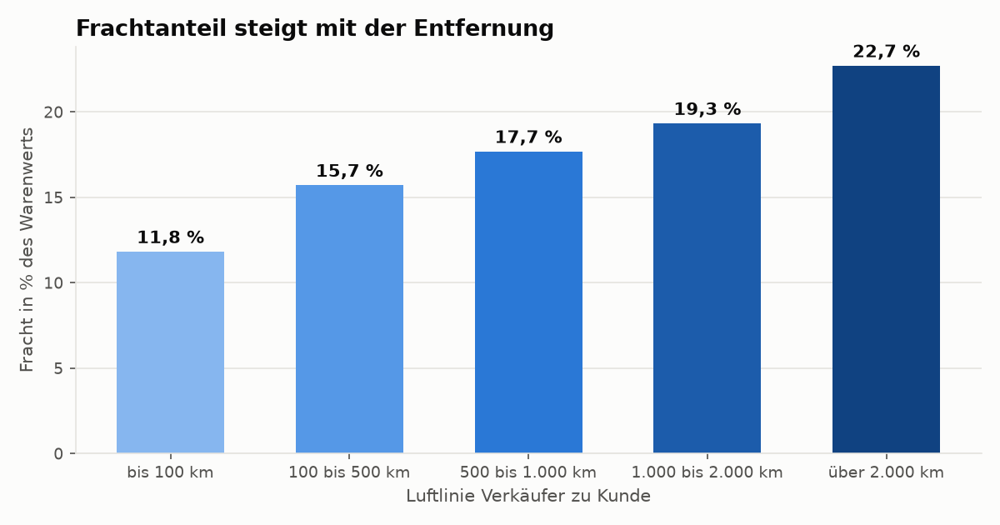
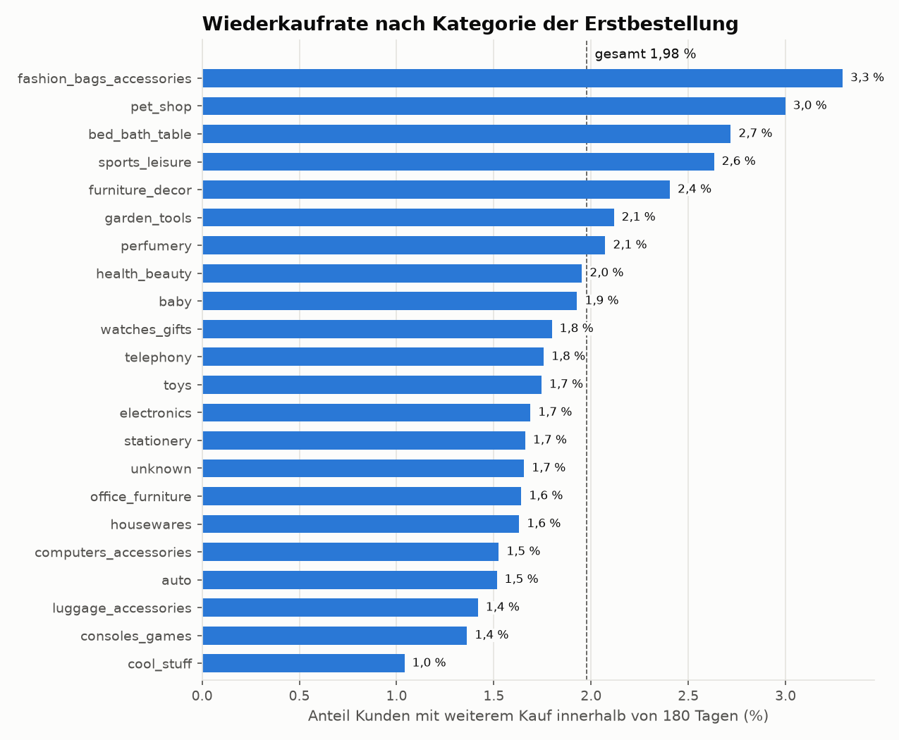
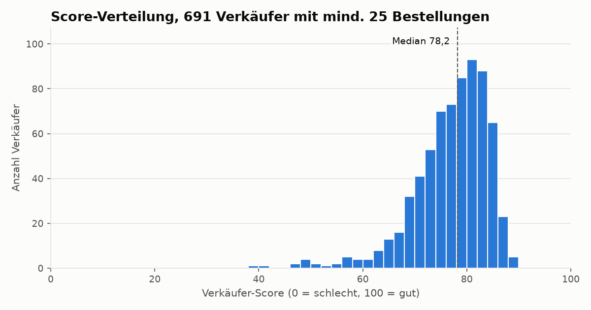
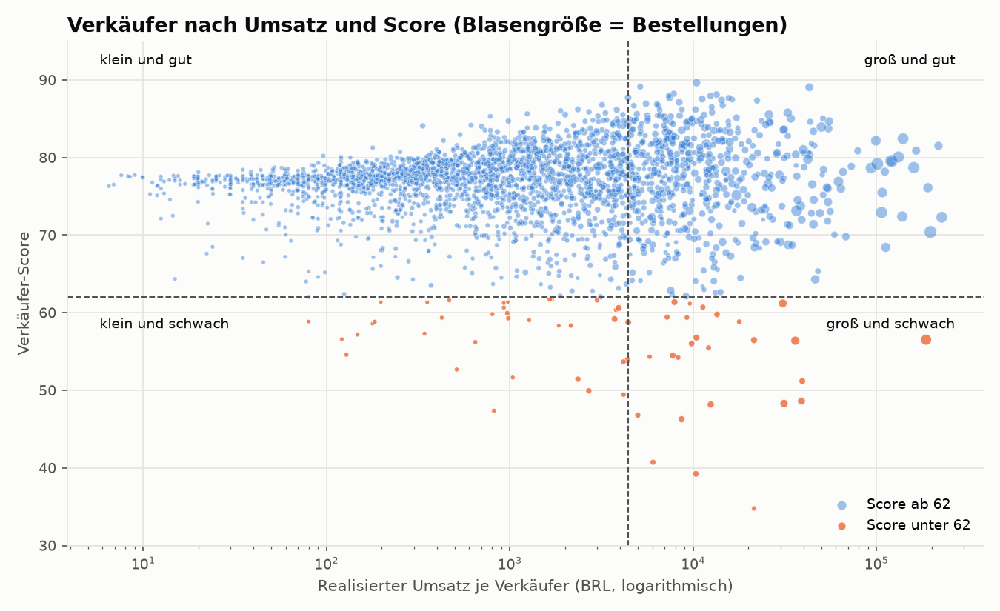

# Commercial & Operations Analytics — Marktplatz-Analyse

**Business-Frage:** Wo verliert ein Online-Marktplatz Kundenzufriedenheit und Marge, und welche Verkäufer sollte er steuern, fördern oder aussortieren?

**Kernergebnis:** Auf die 62 Verkäufer unterhalb Score 62 entfallen 9,7 % aller Ein-Stern-Bewertungen bei nur 4,8 % des Umsatzes. Ein Ausschluss kostet 4,8 % Umsatz und hebt die Durchschnittsbewertung rechnerisch nur um 0,03 Sterne (4,16 auf 4,19). Der größere Hebel ist das Lieferversprechen: Pünktliche Lieferungen erhalten 4,29 Sterne, mehr als eine Woche Verzug 1,70.

**Stack:** DuckDB (SQL, 9 verknüpfte Tabellen) · Python (pandas, numpy, scipy, matplotlib) · Power BI

---

## Die drei Empfehlungen

1. **Verkäufer: Qualitätsprogramm vor Ausschluss.** Die 173 Verkäufer im unteren Score-Quartil (Score unter 73,6, jeweils mindestens 25 bewertbare Bestellungen) tragen 36,7 % der Ein-Stern-Bewertungen bei 23,3 % des Umsatzes. Empfehlung: ein verpflichtendes Qualitätsprogramm für dieses Quartil mit Fokus auf Versandzeit und Pünktlichkeit, beginnend bei den 27 großen, schwachen Verkäufern mit 4,4 % des Umsatzes. Ausschluss nur unter Score 62 und erst, wenn die Verbesserung ausbleibt. Er kostet 4,8 % Umsatz, hebt die Durchschnittsbewertung aber nur um 0,03 Sterne, und mit einem Score aus dem Vorjahr schrumpft die Wirkung auf rund ein Drittel.

2. **Lieferversprechen: realistischer zusagen, zuerst im Nordeste.** Im Nordeste liegt die Verspätungsquote bei 12,76 % gegenüber 6,79 % im Gesamtmarkt, in Alagoas bei 21,46 %. Bei gleicher Lieferdauer geht ein gebrochenes Versprechen mit 1,54 Sternen weniger einher, eine Woche längere Lieferzeit nur mit 0,15 Sternen. Empfehlung: Lieferzusagen aus der tatsächlichen Laufzeit je Route ableiten statt schnellere Logistik einzukaufen. Rechnerisch senken 7 Tage mehr Zusage die Verspätungsquote im Nordeste auf 6,57 %. Weil die Zusage dort im Median schon 31 Tage beträgt und eine längere Zusage Käufe kosten kann, gehört die Änderung in einen A/B-Test. Der Test prüft zugleich, ob der Zusammenhang zwischen Verzug und Bewertung kausal ist.

3. **Fracht: Versandschwelle für Kleinteile, Lager näher am Nordosten.** In der Kategorie electronics beträgt die Fracht 29,5 % des Warenwerts bei einem Durchschnittspreis von 56,79 BRL, in telephony 22,4 %. Über 2.000 km steigt der Frachtanteil auf 22,7 % gegenüber 11,8 % bis 100 km, und 83,7 % aller Positionen kommen von Verkäufern aus dem Sudeste. Die teuersten Routen führen von São Paulo in den Nordosten, zum Beispiel nach Paraíba mit 43,31 BRL je Position und nach Maranhão mit 31,2 % des Warenwerts. Empfehlung: ein Mindestbestellwert oder Bündelrabatt für günstige Kleinteile und mittelfristig regionale Lagerhaltung für die volumenstärksten Nordost-Routen.

---

## Daten

Brazilian E-Commerce Public Dataset by Olist (Kaggle: `olistbr/brazilian-ecommerce`), Lizenz **CC BY-NC-SA 4.0** (nicht-kommerziell, Namensnennung, Weitergabe unter gleichen Bedingungen). Verkäufer- und Firmennamen sind im Datensatz pseudonymisiert. Die abgeleiteten CSV-Dateien in `03_dashboard/exports/` stehen unter derselben Lizenz.

- 99.441 Bestellungen, 112.650 Positionen, 103.886 Zahlungszeilen, 99.224 Bewertungen
- 96.096 reale Kunden (über `customer_unique_id`), 3.095 Verkäufer, 32.951 Produkte
- Zeitraum der Rohdaten: September 2016 bis Oktober 2018
- **Analysefenster: Januar 2017 bis August 2018.** Vor 2017 liegen nur 329 Bestellungen, 324 davon im Oktober 2016 und im November 2016 keine. Nach August 2018 folgen nur noch 20, weil der Datenabzug dort endet. Beide Ränder würden Zeitreihen mit einem leeren Anfang und einem künstlichen Absturz verzerren. Das Fenster behält 99.092 Bestellungen (99,65 %).
- Währung: Brasilianischer Real (BRL)

### Beziehungsdiagramm

```
customers (customer_id, customer_unique_id)      geolocation (zip_prefix, lat, lng)
      |1                                                 | viele Zeilen je zip_prefix
      |                                                  | -> vor Join auf Median verdichten
      |1                                                 |
   orders (order_id) ---------------------------- sellers (seller_id, zip_prefix)
      |1              |1             |1                  |1
      |n              |n             |0..n               |n
 order_items     order_payments   order_reviews     order_items.seller_id
 (order_id,      (order_id,       (order_id,
  order_item_id)  payment_seq)     review_id)
      |n
      |1
   products (product_id, category_pt) --1--1-- category_translation (category_pt -> en)
```

Die Kanten sind gemessen, nicht angenommen: Eine Bestellung hat bis zu 21 Positionen (9.803 Bestellungen mit mehr als einer), 2.961 Bestellungen haben mehrere Zahlungszeilen, 547 mehrere Bewertungen, 775 gar keine Position (fast alle mit Status `unavailable` oder `canceled`). Belegt in `01_sql/02_validation.sql`, Teil A.

## Methodik

1. Neun Rohtabellen in DuckDB geladen und Schlüsselbeziehungen geprüft (`01_sql/00_load.sql`, `01_sql/02_validation.sql` Teil A)
2. Star-Schema mit vier Dimensionen (`dim_date`, `dim_customer`, `dim_seller`, `dim_product`) und zwei Faktentabellen: `fact_order_items` auf Positionsebene und `fact_orders` auf Bestellebene, vorverdichtet gegen Fan-out (`01_sql/01_schema.sql`)
3. Datenqualitätsprüfungen inklusive Zahlungsabstimmung und Fan-out-Nachweis (`01_sql/02_validation.sql`, Teil B)
4. Kommerzielle Analysen: Umsatz, Kategorien, Regionen, Zahlverhalten (`01_sql/03_commercial.sql`)
5. Operations: Lieferzeit-Zerlegung, Verzug gegen Versprechen, Bewertungen, Fracht (`01_sql/04_operations.sql`), vertieft mit Gegenprobe, Regression und Robustheitsprüfungen (`02_python/02_delivery_analysis.py`)
6. Kunden: RFM-Segmente und Merkmale der Wiederkäufer (`02_python/04_rfm.py`)
7. Verkäufer: Konzentration, Kennzahlen und Kohorten (`01_sql/05_sellers.sql`), Scorecard (`02_python/03_seller_score.py`), Cutoff-Analyse mit Gegenprobe außerhalb der Stichprobe (`02_python/05_cutoff_analysis.py`)
8. Exporte und Measures für das Power-BI-Dashboard (`02_python/06_dashboard_exports.py`, `03_dashboard/`)

## Ergebnisse

### Kommerz

- **Wachstum.** Im Analysefenster entstehen 13,18 Mio. BRL realisierter Warenumsatz aus 96.211 zugestellten Bestellungen. Januar bis August 2018 liegt 141,1 % über dem Vorjahreszeitraum, die Spitze liegt im November 2017 mit 987.765 BRL.
- **Kategorien.** 18 von 74 Kategorien machen 81,3 % des Umsatzes. Spitzenreiter ist health_beauty mit 9,33 %.
- **Regionen.** Der Sudeste trägt 68,6 % der Bestellungen beim niedrigsten Bestellwert von 130,61 BRL. Im Norte liegt der Bestellwert bei 181,96 BRL, die Fracht aber bei 22,7 % des Warenwerts statt 15,2 %.
- **Zahlung.** Kreditkarte ist Hauptzahlart bei 75,44 % der Bestellungen. Die Ratenzahl steigt mit dem Bestellwert von 2,08 auf 7,29.

### Operations

- **Lieferzeit.** Im Schnitt dauert eine Lieferung 12,6 Tage: 0,4 Tage Freigabe, 2,8 Tage Bearbeitung beim Verkäufer, 9,4 Tage Transport. Die Bearbeitung ist in allen Regionen gleich, der Transport reicht von 7,6 Tagen im Sudeste bis 19,3 Tagen im Norte.
- **Verzug.** 6,79 % der Zustellungen kommen nach dem versprochenen Datum, im Nordeste 12,76 %. Ausreißer-Monate sind November 2017 sowie Februar und März 2018 mit bis zu 18,96 %.
- **Verzug und Bewertung.** Je größer der Verzug gegen das Versprechen, desto schlechter die Bewertung:

| Verzug gegen Versprechen | Anteil | Ø Bewertung | Ein-Stern-Anteil |
|---|---|---|---|
| pünktlich | 93,33 % | 4,29 | 6,6 % |
| 1 bis 3 Tage | 1,94 % | 3,29 | 25,1 % |
| 4 bis 7 Tage | 1,83 % | 2,10 | 58,6 % |
| über 7 Tage | 2,91 % | 1,70 | 69,8 % |

Das ist ein Zusammenhang, kein Kausalnachweis (siehe Annahmen und Limitationen).


- **Versprechen schlägt Dauer.** Auch pünktliche Lieferungen werden mit wachsender Dauer etwas schlechter bewertet, von 4,42 bei bis zu 7 Tagen auf 3,67 bei über 30 Tagen. Bei gleicher Dauer geht ein gebrochenes Versprechen aber mit 1,54 Sternen weniger einher, eine Woche längere Lieferung nur mit 0,15 Sternen. Verspätete Bestellungen sind 6,7 % der bewerteten Bestellungen und 36,8 % aller Ein-Stern-Bewertungen.


- **Fracht.** Den höchsten Frachtanteil hat electronics mit 29,5 % des Warenwerts. Über Regionsgrenzen steigt der Frachtanteil von 13,0 % auf 18,8 %.
- **Frachttreiber.** Gewicht erklärt allein 37 % der Streuung des Frachtwerts, Entfernung 15 %, Gewicht, Volumen und Entfernung zusammen 56 %. Der Frachtanteil steigt von 11,8 % bis 100 km auf 22,7 % über 2.000 km.



### Kunden

- **Wiederkauf ist selten.** Nur 2,15 % der Kunden kaufen an mehr als einem Tag, innerhalb von 180 Tagen nach dem Erstkauf 1,98 %. Eine klassische Kunden-Kohortenanalyse wäre daher fast leer.
- **Kategorie und Region unterscheiden Wiederkäufer, der Service kaum messbar.** Wer zuerst Taschen und Accessoires, Tierbedarf oder Heimtextilien kauft, kommt bis zu dreimal so oft wieder wie bei cool_stuff (3,3 % gegenüber 1,0 %). Bewertung und Pünktlichkeit der Erstbestellung zeigen in die erwartete Richtung, sind aber statistisch nicht abgesichert.



### Verkäufer

- **Konzentration.** Die Top 10 % der 2.945 Verkäufer mit Umsatz machen 67,0 % des Umsatzes, die untere Hälfte 3,4 %. 60 % der Verkäufer haben weniger als 10 zugestellte Bestellungen.
- **Verkäufer-Kohorten.** Von einer Startkohorte sind nach einem Monat noch 57,6 % aktiv, nach 12 Monaten 35,2 %.
- **Scorecard.** Bewertung 40 %, Verspätungsquote 30 %, Bearbeitungszeit 15 %, Stornoquote 15 %, jede Kennzahl zum Marktmittel gedämpft. Das Ranking ist robust gegenüber anderen Gewichten (Rangkorrelation 0,96 bis 0,98).



- **Cutoff.** Gewählt ist die höchste Schwelle mit höchstens 5 % Umsatzverlust: Score 62.

| Kennzahl | Score 62, ganzes Fenster | Gegenprobe: Score aus 2017, Wirkung 2018 |
|---|---|---|
| Anteil an Ein-Stern-Bewertungen | 9,7 % | 3,3 % |
| Anteil am Umsatz | 4,8 % | 2,2 % |
| Veränderung Ø Bewertung | +0,03 Sterne | +0,01 Sterne |


- **Quadranten.** 27 große, aber schwache Verkäufer tragen 4,4 % des Umsatzes und sind der eigentliche Steuerungsfall. 35 kleine, schwache Verkäufer tragen 0,4 %.



- **Unteres Quartil.** Die 173 Verkäufer im unteren Score-Quartil der verlässlich bewerteten Verkäufer (mindestens 25 Bestellungen) tragen 36,7 % der Ein-Stern-Bewertungen bei 23,3 % des Umsatzes.

## Dashboard

Vier Seiten in Power BI: Marktplatz-Überblick, Operations, Verkäufer, Cutoff-Simulator. Der Bauplan mit Visuals, Feldern, Achsen und Kontrollwerten steht in `03_dashboard/layout.md`, die Measures in `03_dashboard/measures.dax`, die Daten in `03_dashboard/exports/`.

[Screenshot Seite 1, Marktplatz-Überblick: 03_dashboard/screenshots/01_overview.png]

[Screenshot Seite 2, Operations: 03_dashboard/screenshots/02_operations.png]

[Screenshot Seite 3, Verkäufer: 03_dashboard/screenshots/03_sellers.png]

[Screenshot Seite 4, Cutoff-Simulator: 03_dashboard/screenshots/04_cutoff_simulator.png]

## Annahmen und Limitationen

**Datenmodell und Datenqualität** (jede Aussage belegt in `01_sql/02_validation.sql`)

- **Kundenkennung.** Kundenbezogene Kennzahlen laufen ausschließlich über `customer_unique_id`. `customer_id` wird pro Bestellung neu vergeben und ist nur der technische Join-Schlüssel zu `orders`. Über `customer_id` wäre die Wiederkaufrate exakt null; tatsächlich haben 2.997 Personen mehr als eine Bestellung.
- **Fan-out.** Der naive Join von Bestellungen, Positionen und Zahlungen ergibt 117.601 Zeilen statt 99.441 und überhöht den Zahlbetrag um 26,9 %. `fact_orders` ist deshalb je `order_id` vorverdichtet und trifft den Warenumsatz von 13.591.643,70 BRL auf den Cent.
- **Umsatz** ist die Summe der Positionspreise (`price`) zugestellter Bestellungen. Sie tragen 97,34 % des Warenumsatzes im Fenster. Fracht wird getrennt geführt, der Zahlbetrag nur für Zahlungsanalysen verwendet.
- **Zahlungsabstimmung.** 254 von 98.665 Bestellungen (0,26 %) weichen beim Zahlbetrag um mehr als 1 % von Warenwert plus Fracht ab, fast alle mit Kreditkarte.
- **Bestellstatus.** Lieferzeit und Bewertung nur für `delivered` mit gefülltem Zustelldatum (96.203 Bestellungen im Fenster). `canceled` und `unavailable` laufen getrennt als Stornoquote (1,19 % im Fenster).
- **Mehrfachbewertungen.** Bei 547 Bestellungen mit mehreren Bewertungen zählt die jüngste.
- **Zeitstempel.** Bei 1.359 Bestellungen liegt die Übergabe an die Logistik vor der Zahlungsfreigabe. Für die Lieferzeit-Zerlegung zählen nur Bestellungen ohne negative Teilzeiten.
- **Geolocation** wird vor dem Join auf den Median je PLZ-Präfix verdichtet, 42 Koordinaten außerhalb Brasiliens werden verworfen.
- **Regionen.** Bundesstaat und Region des Kunden kommen aus der Kundendimension (Adresse der jüngsten Bestellung). Das ordnet nur 43 Bestellungen (0,043 %) anders zu als ihre eigene Lieferadresse.

**Analyse**

- **Zusammenhang, keine Kausalität.** Verzug und Bewertung hängen stark zusammen, auch innerhalb von Bestellungen mit nur einer Position und in jeder Region. Mögliche Störfaktoren sind nachlässige Verkäufer, defekte oder falsch beschriebene Ware und entlegene Lieferadressen. Bestellungen mit mehreren Verkäufern werden schlecht bewertet, obwohl sie fast nie verspätet sind. Es gibt also weitere Treiber.
- **Leitgröße Verzug.** Verzug wird in Kalendertagen gerechnet (Zustelldatum minus versprochenes Datum, positiv heißt zu spät), weil das Versprechen ein Datum ohne Uhrzeit ist.
- **Entfernung als Luftlinie** zwischen den Median-Koordinaten der PLZ-Präfixe, nicht als Straßenkilometer.
- **Wiederkaufrate sehr niedrig.** Als Wiederkauf zählt nur ein späterer Kauftag innerhalb von 180 Tagen, Bestellungen am selben Tag gelten als ein Kauf. Kunden-Retention ist bei rund 2 % Wiederkäufern wenig aussagekräftig. Deshalb gibt es Verkäufer-Kohorten statt Kunden-Kohorten.
- **Gewichte der Scorecard sind gesetzt, nicht optimiert** (40/30/15/15). Die Sensitivitätsprüfung zeigt, dass das Ranking kaum an ihnen hängt.
- **Verkäufer mit wenigen Bestellungen haben instabile Scores.** Ihre Kennzahlen werden zum Marktmittel gedämpft. Die Dämpfungsstärke ist je Kennzahl aus den Daten geschätzt, bei der Bewertung sind es 26 Bestellungen.
- **Bewertung, Verspätung und Bearbeitung je Verkäufer** zählen nur Bestellungen mit genau einem Verkäufer (98,7 %), weil sich die Bewertung sonst keinem Verkäufer zuordnen lässt.
- **Cutoff über ein Umsatzbudget von 5 %.** Ohne Margendaten ist kein Gewinnoptimum berechenbar. Der Effekt im ganzen Fenster ist optimistisch, weil der Score dieselben Bewertungen enthält. Die Gegenprobe mit einem Score aus 2017 auf die Bestellungen von 2018 zeigt rund ein Drittel davon.
- **Brasilianischer Markt.** Logistik und Zahlungsgewohnheiten wie Boleto und Ratenzahlung sind nicht direkt auf Europa übertragbar.

## Reproduktion

Voraussetzung: Python 3.11 oder neuer und die neun CSV-Dateien des Kaggle-Datensatzes `olistbr/brazilian-ecommerce`. Sie gehören nach `data/raw/` und sind nicht im Repo enthalten.

```bash
git clone <repo-url> marketplace-commercial-analytics
cd marketplace-commercial-analytics
python -m venv .venv
source .venv/bin/activate        # Windows: .venv\Scripts\activate
pip install -r requirements.txt
# Kaggle-CSVs nach data/raw/ kopieren

python 02_python/01_data_prep.py
python 02_python/run_sql.py 01_sql/02_validation.sql
python 02_python/run_sql.py 01_sql/03_commercial.sql
python 02_python/run_sql.py 01_sql/04_operations.sql
python 02_python/02_delivery_analysis.py
python 02_python/04_rfm.py
python 02_python/run_sql.py 01_sql/05_sellers.sql
python 02_python/03_seller_score.py
python 02_python/05_cutoff_analysis.py
python 02_python/06_dashboard_exports.py
```

- `01_data_prep.py` lädt die CSVs (`00_load.sql`), baut das Star-Schema (`01_schema.sql`) und bricht ab, wenn eine von drei Prüfungen scheitert: `fact_orders` hat so viele Zeilen wie `orders` (99.441), die Wiederkaufrate über `customer_unique_id` ist größer null (3,12 %), `02_validation.sql` läuft fehlerfrei.
- `05_sellers.sql` muss vor `03_seller_score.py` laufen, weil es die Views anlegt, aus denen die Scorecard liest. Die Nummern der Python-Skripte folgen der Projektgliederung, nicht ganz der Ausführungsreihenfolge.
- Der komplette Lauf dauert auf einem Laptop wenige Minuten und liefert bei jedem Lauf identische Ergebnisdateien.
- Eine Datei-für-Datei-Erklärung in Ausführungsreihenfolge steht in `reports/walkthrough.md`.

## Repo-Struktur

```
01_sql/
  00_load.sql             CSVs in DuckDB laden
  01_schema.sql           Star-Schema aufbauen
  02_validation.sql       Datenqualitätsprüfungen (Teil A Rohdaten, Teil B Schema)
  03_commercial.sql       Abfragen 5-8: Umsatz, Kategorien, Regionen, Zahlung
  04_operations.sql       Abfragen 9-12: Lieferzeit, Verzug, Bewertung, Fracht
  05_sellers.sql          Abfragen 13-15: Konzentration, Kennzahlen, Kohorten
02_python/
  run_sql.py              führt eine SQL-Datei aus und zeigt die Ergebnisse
  chart_style.py          gemeinsamer Diagrammstil
  01_data_prep.py         Laden, Schema, Pflichtprüfungen
  02_delivery_analysis.py Verzug gegen Bewertung, Frachttreiber
  03_seller_score.py      Verkäufer-Scorecard
  04_rfm.py               RFM und Wiederkäufer
  05_cutoff_analysis.py   Trade-off und Wahl des Cutoffs
  06_dashboard_exports.py CSV-Exporte für Power BI
03_dashboard/
  exports/                CSV-Dateien für Power BI
  layout.md               Seitenaufbau des Dashboards
  measures.dax            DAX-Measures
  screenshots/            Dashboard-Screenshots
data/
  raw/                    Kaggle-CSVs (nicht im Repo)
  processed/              Platz für Zwischenstände (derzeit leer)
  olist.duckdb            DuckDB-Datei (wird erzeugt, nicht im Repo)
reports/
  findings.md             je Arbeitsschritt: was gemacht, was herauskam, warum
  interview_notes.md      typische Interviewfragen mit Antworten
  walkthrough.md          das Repo Datei für Datei erklärt
  figures/                Diagramme
```
